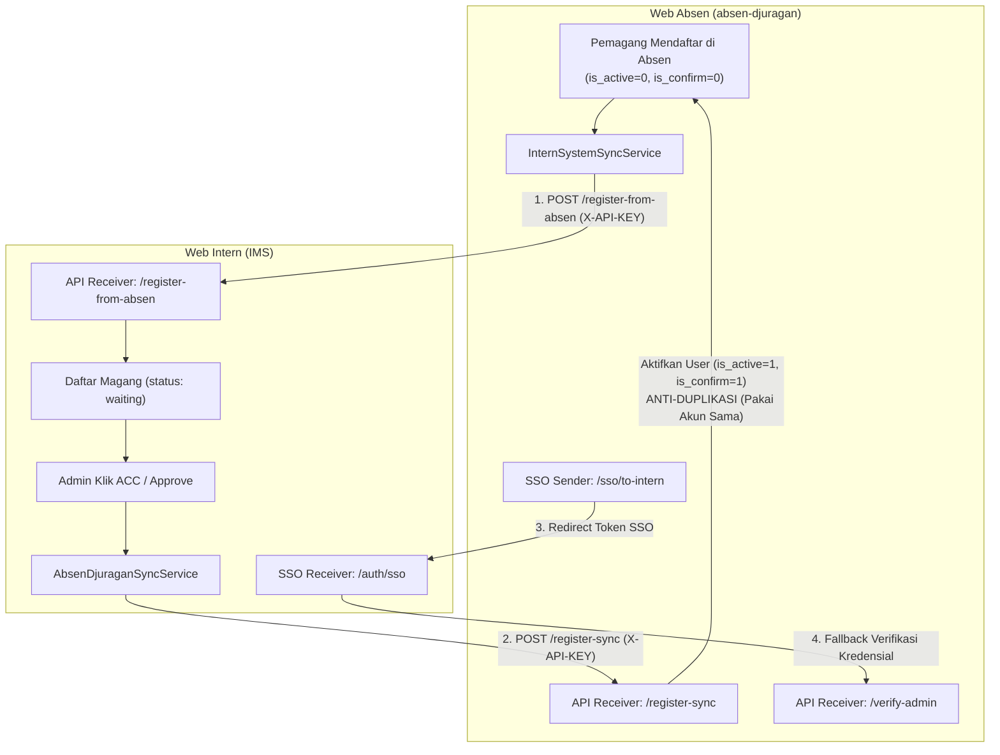

# 📘 Dokumentasi Integrasi API & Single Sign-On (SSO): Web Intern ⟷ Web Absen

Dokumen ini berisi panduan lengkap mengenai arsitektur, cara mengatur, mengganti URL/domain, merotasi API Key, spesifikasi endpoint, mekanisme anti-duplikasi, serta pengujian integrasi dua arah antara **Web Intern (`Internship Management System / IMS`)** dan **Web Absen (`absen-djuragan`)**.

---

## 📑 Daftar Isi
1. [Arsitektur & Alur Integrasi Dua Arah](#1-arsitektur--alur-integrasi-dua-arah)
2. [Mekanisme Anti-Duplikasi & Siklus Hidup Akun](#2-mekanisme-anti-duplikasi--siklus-hidup-akun)
3. [Tabel Pemetaan Variabel Lingkungan (.env)](#3-tabel-pemetaan-variabel-lingkungan-env)
4. [Panduan Konfigurasi di Web Intern (`IMS`)](#4-panduan-konfigurasi-di-web-intern-ims)
5. [Panduan Konfigurasi di Web Absen (`absen-djuragan`)](#5-panduan-konfigurasi-di-web-absen-absen-djuragan)
6. [Langkah Demi Langkah Mengganti Domain / Port / URL API](#6-langkah-demi-langkah-mengganti-domain--port--url-api)
   - [Skenario A: Laragon Virtual Host (Lokal Default)](#skenario-a-laragon-virtual-host-lokal-default)
   - [Skenario B: PHP Artisan Serve (Port Berbeda)](#skenario-b-php-artisan-serve-port-berbeda)
   - [Skenario C: Lingkungan Produksi (Live Domain / VPS)](#skenario-c-lingkungan-produksi-live-domain--vps)
   - [Skenario D: Merotasi / Mengganti API Key](#skenario-d-merotasi--mengganti-api-key)
7. [Spesifikasi Endpoint API](#7-spesifikasi-endpoint-api)
   - [1. Health Check Intern & Absen](#1-health-check-intern--absen)
   - [2. Pendaftaran Pemagang dari Absen ke Intern (`register-from-absen`)](#2-pendaftaran-pemagang-dari-absen-ke-intern-register-from-absen)
   - [3. Sinkronisasi ACC Pemagang dari Intern ke Absen (`register-sync`)](#3-sinkronisasi-acc-pemagang-dari-intern-ke-absen-register-sync)
   - [4. Verifikasi Remote Admin (`verify-admin`)](#4-verifikasi-remote-admin-verify-admin)
   - [5. Single Sign-On (SSO) Token Protocol](#5-single-sign-on-sso-token-protocol)
8. [Daftar File Kunci di Kedua Project](#8-daftar-file-kunci-di-kedua-project)
9. [Uji Coba & Troubleshooting](#9-uji-coba--troubleshooting)

---

## 1. Arsitektur & Alur Integrasi Dua Arah

Kedua aplikasi dibangun dengan Laravel dan terhubung secara dua arah (bidirectional) tanpa mengubah struktur database di Web Absen:



### Penjelasan Fitur Integrasi:

1. **Pendaftaran dari Web Absen ke Web Intern (`register-from-absen`)**:
   Saat pemagang mengisi form pendaftaran di Web Absen, akun `User` di Web Intern otomatis dibuat dengan role `'user'`. Data lengkap (nama, tanggal lahir, tempat lahir, gender, agama, nomor telepon, asal sekolah, NIM, alamat domisili) otomatis masuk ke tabel formulir **Daftar Magang** (`internship_registrations`) di Web Intern dengan status awal `'waiting'`.
2. **Sinkronisasi Pemagang Saat di-ACC (`register-sync`) dengan Anti-Duplikasi**:
   Saat Admin di Web Intern memverifikasi dan menyetujui (ACC) pemagang di Daftar Magang (status berubah menjadi `accepted` atau `active`), Web Intern mengirim sinyal ke Web Absen. Sistem Web Absen mencari user berdasarkan email. Jika user sudah ada (karena mendaftar dari Absen), akun yang sama langsung diaktifkan (`is_active = true`, `is_confirm = true`) tanpa menduplikasi data, serta mempertahankan titik koordinat GPS domisili yang sudah diisi.
3. **Single Sign-On (SSO) Admin**:
   Admin/Super Admin di Web Absen dapat langsung masuk ke dashboard Web Intern dengan satu klik via token HMAC-SHA256 berdurasi 60 detik.
4. **Remote Login Fallback (`verify-admin`)**:
   Jika Super Admin atau Admin Web Absen login di Web Intern namun datanya belum ada di Intern, sistem memvalidasi password ke Web Absen dan membuatkan akun admin otomatis.

---

## 2. Mekanisme Anti-Duplikasi & Siklus Hidup Akun

Integrasi ini dirancang dengan prinsip **Idempotensi & Konsistensi Data**:

| Tahapan | Status di Web Absen | Status di Web Intern | Catatan Integritas |
|---|---|---|---|
| **1. Pemagang mendaftar di Web Absen** | Akun terbuat di `users` (`role_id: 3`, `is_active: false`, `is_confirm: false`). Titik koordinat GPS domisili tersimpan. | Akun terbuat di `users` (`role: user`). Formulir terbuat di `internship_registrations` (`status: waiting`). | Password sinkron (bisa login dengan password yang sama di kedua sistem). |
| **2. Admin di Web Intern meninjau & ACC pemagang** | Akun diperbarui menjadi `is_active: true`, `is_confirm: true`. Divisi/Brand/Periode diupdate. | Akun diperbarui menjadi `role: pemagang`. Formulir menjadi `status: accepted` / `active`. | **TIDAK MENDUPLIKASI**: Akun user lama di Absen digunakan kembali, koordinat rumah & NIM tidak terhapus. |
| **3. Pemagang Login di Absen** | Bisa langsung login karena `is_active` dan `is_confirm` sudah `true`. | Bisa login ke dashboard pemagang di Intern. | Pengalaman pengguna mulus tanpa perlu aktivasi manual dua kali. |

---

## 3. Tabel Pemetaan Variabel Lingkungan (.env)

Kedua project harus memiliki konfigurasi yang berpasangan dan selaras:

| Variabel di Web Intern (`IMS`) | Variabel di Web Absen (`absen-djuragan`) | Keterangan | Nilai Sinkron |
|---|---|---|---|
| `ABSEN_DJURAGAN_API_KEY` | `EXTERNAL_API_KEY` | **Secret Key bersama** untuk autentikasi API dua arah dan HMAC token SSO. | **WAJIB SAMA PERSIS** |
| `APP_URL` | `INTERN_SYSTEM_URL` | URL dasar / domain Web Intern yang dituju oleh Web Absen. | Mengarah ke Web Intern |
| `ABSEN_DJURAGAN_WEB_URL` | `APP_URL` | URL dasar / domain Web Absen yang digunakan oleh Web Intern. | Mengarah ke Web Absen |
| `ABSEN_DJURAGAN_API_URL` | - | Endpoint prefix API eksternal Web Absen yang dipanggil oleh Web Intern. | `{Web_Absen}/api/v1/external` |

---

## 4. Panduan Konfigurasi di Web Intern (`IMS`)

### 1. File `.env` di `Internship_Management_System_SevenInc-develop`
```env
# ==============================================================================
# INTEGRASI KE WEB ABSEN (Absen Djuragan)
# ==============================================================================
ABSEN_DJURAGAN_API_URL=http://absen-djuragan.test/api/v1/external
ABSEN_DJURAGAN_WEB_URL=http://absen-djuragan.test
ABSEN_DJURAGAN_API_KEY=djuragan_ext_140633f34edfaf504a3d6812c8c2485c
```

### 2. File `config/services.php` di `IMS`
```php
'absen_djuragan' => [
    'url'     => env('ABSEN_DJURAGAN_API_URL', 'http://absen-djuragan.test/api/v1/external'),
    'web_url' => env('ABSEN_DJURAGAN_WEB_URL', 'http://absen-djuragan.test'),
    'api_key' => env('ABSEN_DJURAGAN_API_KEY', 'djuragan_ext_140633f34edfaf504a3d6812c8c2485c'),
],
```

---

## 5. Panduan Konfigurasi di Web Absen (`absen-djuragan`)

### 1. File `.env` di `absen-djuragan`
```env
# ==============================================================================
# INTEGRASI KE WEB INTERN (Internship Management System)
# ==============================================================================
EXTERNAL_API_KEY=djuragan_ext_140633f34edfaf504a3d6812c8c2485c
INTERN_SYSTEM_URL=http://Internship_Management_System_SevenInc-develop.test
```

### 2. File `config/services.php` di `absen-djuragan`
```php
'external' => [
    'api_key' => env('EXTERNAL_API_KEY'),
],

'intern_system' => [
    'url'     => env('INTERN_SYSTEM_URL', 'http://Internship_Management_System_SevenInc-develop.test'),
    'api_key' => env('INTERN_SYSTEM_API_KEY', env('EXTERNAL_API_KEY', 'djuragan_ext_140633f34edfaf504a3d6812c8c2485c')),
],
```

---

## 6. Langkah Demi Langkah Mengganti Domain / Port / URL API

### Skenario A: Laragon Virtual Host (Lokal Default)
Secara bawaan Laragon membuat URL virtual host berekstensi `.test`:
- Web Intern: `http://Internship_Management_System_SevenInc-develop.test`
- Web Absen: `http://absen-djuragan.test`

Gunakan konfigurasi default yang sudah tertulis di atas tanpa perlu diubah.

---

### Skenario B: PHP Artisan Serve (Port Berbeda)
Jika Anda menjalankan project tanpa Laragon menggunakan terminal manual:
- Web Intern di Terminal 1: `php artisan serve --port=8001` (`http://127.0.0.1:8001`)
- Web Absen di Terminal 2: `php artisan serve --port=8000` (`http://127.0.0.1:8000`)

1. **Ubah di `Internship_Management_System_SevenInc-develop/.env`**:
   ```env
   APP_URL=http://127.0.0.1:8001
   ABSEN_DJURAGAN_API_URL=http://127.0.0.1:8000/api/v1/external
   ABSEN_DJURAGAN_WEB_URL=http://127.0.0.1:8000
   ```
2. **Ubah di `absen-djuragan/.env`**:
   ```env
   APP_URL=http://127.0.0.1:8000
   INTERN_SYSTEM_URL=http://127.0.0.1:8001
   ```
3. Bersihkan cache: `php artisan config:clear` di kedua terminal.

---

### Skenario C: Lingkungan Produksi (Live Domain / VPS)
Jika kedua aplikasi di-deploy ke server online:
- Domain Web Intern: `https://intern.seveninc.id`
- Domain Web Absen: `https://absen.seveninc.id`

1. **Di `Internship_Management_System_SevenInc-develop/.env`**:
   ```env
   APP_URL=https://intern.seveninc.id
   ABSEN_DJURAGAN_API_URL=https://absen.seveninc.id/api/v1/external
   ABSEN_DJURAGAN_WEB_URL=https://absen.seveninc.id
   ABSEN_DJURAGAN_API_KEY=ganti_dengan_token_rahasia_produksi
   ```

2. **Di `absen-djuragan/.env`**:
   ```env
   APP_URL=https://absen.seveninc.id
   INTERN_SYSTEM_URL=https://intern.seveninc.id
   EXTERNAL_API_KEY=ganti_dengan_token_rahasia_produksi
   ```

3. Jalankan cache: `php artisan config:cache` di kedua project.

---

### Skenario D: Merotasi / Mengganti API Key
1. Buat string token acak baru:
   ```bash
   php -r "echo 'djuragan_ext_' . bin2hex(random_bytes(16));"
   ```
2. Salin token tersebut ke:
   - `ABSEN_DJURAGAN_API_KEY` di `Internship_Management_System_SevenInc-develop/.env`
   - `EXTERNAL_API_KEY` di `absen-djuragan/.env`
3. Jalankan `php artisan config:clear` di kedua project.

---

## 7. Spesifikasi Endpoint API

Semua endpoint external dilindungi oleh header `X-API-KEY`.

### 1. Health Check Intern & Absen

- **Intern Health**: `GET http://Internship_Management_System_SevenInc-develop.test/api/v1/external/health`
- **Absen Health**: `GET http://absen-djuragan.test/api/v1/external/health`
- **Headers**:
  ```http
  X-API-KEY: {API_KEY}
  Accept: application/json
  ```
- **Respon Sukses (`200 OK`)**:
  ```json
  {
    "success": true,
    "message": "API is healthy and connected.",
    "server_time": "2026-10-10 16:48:36"
  }
  ```

---

### 2. Pendaftaran Pemagang dari Absen ke Intern (`register-from-absen`)

Dipanggil otomatis oleh Web Absen saat seorang pemagang mendaftar akun baru.

- **Method**: `POST`
- **URL**: `{INTERN_SYSTEM_URL}/api/v1/external/register-from-absen`
- **Headers**:
  ```http
  X-API-KEY: {ABSEN_DJURAGAN_API_KEY}
  Content-Type: application/json
  Accept: application/json
  ```
- **Payload Request (JSON)**:
  ```json
  {
    "email": "ahmad.syahrul@example.com",
    "username": "ahmadsyahrul",
    "password": "Password123!",
    "full_name": "Ahmad Syahrul",
    "phone": "081234567890",
    "gender": "Laki-laki",
    "date_of_birth": "2003-04-12",
    "birth_place": "Yogyakarta",
    "religion": "Islam",
    "address": "Jl. Kaliurang KM 8, Sleman",
    "school_name": "Universitas Gadjah Mada",
    "nim": "21/473829/TK/52100",
    "is_gps_available": 1
  }
  ```
- **Aksi Otomatis di Web Intern**:
  1. Membuat akun di tabel `users` dengan `role = 'user'`.
  2. Resolusi otomatis `Institution` (Sekolah/Kampus), `Faculty`, dan `StudyProgram`. Jika belum ada, otomatis dibuatkan.
  3. Mengisi formulir di `internship_registrations` dengan status `'waiting'`.
- **Respon Sukses (`201 Created` / `200 OK`)**:
  ```json
  {
    "success": true,
    "message": "Akun dan formulir pendaftaran magang berhasil dibuat di Internship Management System.",
    "data": {
      "user_id": 65,
      "name": "Ahmad Syahrul",
      "email": "ahmad.syahrul@example.com",
      "role": "user",
      "registration_id": 60,
      "internship_status": "waiting"
    }
  }
  ```

---

### 3. Sinkronisasi ACC Pemagang dari Intern ke Absen (`register-sync`)

Dipanggil oleh Web Intern saat Admin menyetujui (ACC) pemagang di Daftar Magang.

- **Method**: `POST`
- **URL**: `{ABSEN_DJURAGAN_API_URL}/register-sync`
- **Headers**:
  ```http
  X-API-KEY: {ABSEN_DJURAGAN_API_KEY}
  Content-Type: application/json
  Accept: application/json
  ```
- **Payload Request (JSON)**:
  ```json
  {
    "email": "ahmad.syahrul@example.com",
    "password_hash": "$2y$12$...",
    "full_name": "Ahmad Syahrul",
    "phone": "081234567890",
    "gender": "Laki-laki",
    "born_date": "2003-04-12",
    "birth_place": "Yogyakarta",
    "religion": "Islam",
    "address": "Jl. Kaliurang KM 8, Sleman",
    "school_name": "Universitas Gadjah Mada",
    "student_id": "21/473829/TK/52100",
    "division_name": "Programmer",
    "brand_name": "Seven Inc",
    "start_date": "2026-10-15",
    "end_date": "2027-01-15"
  }
  ```
- **Aksi Otomatis di Web Absen**:
  1. Mencari user berdasarkan email. Jika sudah ada, **tidak menduplikasi akun**.
  2. Mengaktifkan dan mengonfirmasi akun pemagang (`is_active = true`, `is_confirm = true`) sehingga pemagang bisa langsung login di Absen.
  3. Mempertahankan titik GPS domisili (`home_latitude`, `home_longitude`) yang telah diisi pemagang saat daftar di Absen.
- **Respon Sukses (`200 OK`)**:
  ```json
  {
    "success": true,
    "message": "Akun pemagang yang sudah ada berhasil diperbarui di Absen Djuragan.",
    "data": {
      "absen_user_id": 9,
      "username": "ahmadsyahrul",
      "email": "ahmad.syahrul@example.com",
      "full_name": "Ahmad Syahrul",
      "intern_id": 5,
      "division_id": 1,
      "brand_id": 1,
      "school_id": 48,
      "is_active": true
    }
  }
  ```

---

### 4. Verifikasi Remote Admin (`verify-admin`)

- **Method**: `POST`
- **URL**: `{ABSEN_DJURAGAN_API_URL}/verify-admin`
- **Headers**: `X-API-KEY: {KEY}`, `Content-Type: application/json`
- **Payload Request**:
  ```json
  {
    "login": "admin@sevendjuragan.com",
    "password": "password_admin"
  }
  ```
- **Respon Sukses (`200 OK`)**:
  ```json
  {
    "success": true,
    "message": "Kredensial Admin/Super Admin valid.",
    "user": {
      "email": "admin@sevendjuragan.com",
      "username": "superadmin",
      "name": "Super Administrator",
      "role": "admin",
      "role_id": 7,
      "is_super_admin": true
    }
  }
  ```

---

### 5. Single Sign-On (SSO) Token Protocol
- **Arah**: Web Absen -> Web Intern (`GET /auth/sso?token={token}`)
- **Format Token**: `{base64_payload}.{hmac_sha256_signature}`
- **Durasi**: 60 detik (mencegah *replay attack*).

---

## 8. Daftar File Kunci di Kedua Project

### Di Project Web Intern (`Internship_Management_System_SevenInc-develop`):
1. `app/Http/Controllers/Api/AbsenSyncController.php` — Receiver endpoint `register-from-absen` (membuat User & Formulir Daftar Magang) dan `healthCheck`.
2. `app/Http/Middleware/AbsenApiKeyMiddleware.php` — Middleware verifikasi `X-API-KEY`.
3. `routes/api.php` — Mendaftarkan endpoint `v1/external`.
4. `app/Services/AbsenDjuraganSyncService.php` — Service pengirim data saat Admin ACC pemagang ke Web Absen.
5. `app/Http/Controllers/Admin/InternController.php` — Menjalankan `syncIntern()` saat admin mengubah status ke diterima.
6. `app/Http/Controllers/AuthController.php` — Menangani penerimaan token SSO (`ssoLogin`) dan remote login fallback.

### Di Project Web Absen (`absen-djuragan`):
1. `app/Services/InternSystemSyncService.php` — Service pengirim sinkronisasi pendaftaran pemagang ke Web Intern.
2. `app/Services/UserService.php` — Menjalankan `syncRegistration()` setelah registrasi pemagang selesai.
3. `app/Http/Controllers/Api/ExternalRegistrationController.php` — Receiver endpoint `registerSync` (dengan anti-duplikasi & auto-confirm), `verifyAdmin`, dan `healthCheck`.
4. `config/services.php` — Konfigurasi `services.external.api_key` dan `services.intern_system.url`.
5. `app/Http/Controllers/SsoController.php` — Generator token SSO HMAC-SHA256 untuk admin.

---

## 9. Uji Coba & Troubleshooting

### Menguji Health Check via Terminal (cURL)
```bash
# Cek Web Intern
curl -i -H "X-API-KEY: djuragan_ext_140633f34edfaf504a3d6812c8c2485c" http://Internship_Management_System_SevenInc-develop.test/api/v1/external/health

# Cek Web Absen
curl -i -H "X-API-KEY: djuragan_ext_140633f34edfaf504a3d6812c8c2485c" http://absen-djuragan.test/api/v1/external/health
```

### Log File Troubleshooting
Jika terjadi kendala integrasi, periksa file log di:
- Web Intern: `Internship_Management_System_SevenInc-develop/storage/logs/laravel.log`
- Web Absen: `absen-djuragan/storage/logs/laravel.log`
