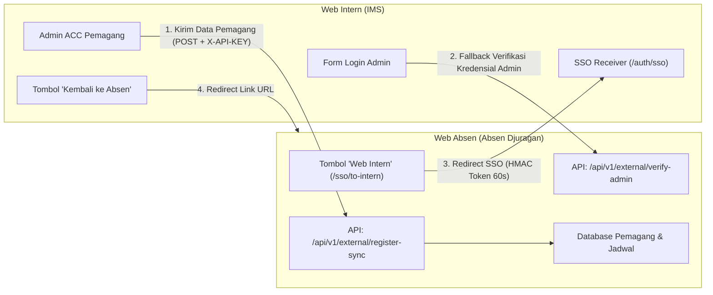

# 📘 Dokumentasi Integrasi API & Single Sign-On (SSO): Web Intern ⟷ Web Absen

Dokumen ini berisi panduan lengkap mengenai arsitektur, cara mengatur, mengganti URL/domain, merotasi API Key, serta menguji integrasi antara **Web Intern (`Internship Management System / IMS`)** dan **Web Absen (`absen-djuragan`)**.

---

## 📑 Daftar Isi
1. [Arsitektur & Alur Integrasi](#1-arsitektur--alur-integrasi)
2. [Tabel Pemetaan Variabel Lingkungan (.env)](#2-tabel-pemetaan-variabel-lingkungan-env)
3. [Panduan Konfigurasi di Web Intern (`IMS`)](#3-panduan-konfigurasi-di-web-intern-ims)
4. [Panduan Konfigurasi di Web Absen (`absen-djuragan`)](#4-panduan-konfigurasi-di-web-absen-absen-djuragan)
5. [Langkah Demi Langkah Mengganti Domain / Port / URL API](#5-langkah-demi-langkah-mengganti-domain--port--url-api)
   - [Skenario A: Laragon Virtual Host (Lokal Default)](#skenario-a-laragon-virtual-host-lokal-default)
   - [Skenario B: PHP Artisan Serve (Port Berbeda)](#skenario-b-php-artisan-serve-port-berbeda)
   - [Skenario C: Lingkungan Produksi (Live Domain / VPS)](#skenario-c-lingkungan-produksi-live-domain--vps)
   - [Skenario D: Merotasi / Mengganti API Key](#skenario-d-merotasi--mengganti-api-key)
6. [Spesifikasi Endpoint API](#6-spesifikasi-endpoint-api)
   - [1. Health Check](#1-health-check)
   - [2. Sinkronisasi Pemagang (Register Sync)](#2-sinkronisasi-pemagang-register-sync)
   - [3. Verifikasi Remote Admin (Verify Admin)](#3-verifikasi-remote-admin-verify-admin)
   - [4. Single Sign-On (SSO) Token Protocol](#4-single-sign-on-sso-token-protocol)
7. [Daftar File Kunci di Kedua Project](#7-daftar-file-kunci-di-kedua-project)
8. [Uji Coba & Troubleshooting](#8-uji-coba--troubleshooting)

---

## 1. Arsitektur & Alur Integrasi

Kedua aplikasi dibangun dengan Laravel dan terhubung melalui 4 fitur utama:



### Penjelasan 4 Fitur:
1. **Sinkronisasi Pemagang Saat di-ACC (`register-sync`)**:
   Saat Admin di Web Intern menerima/meng-ACC pendaftaran pemagang, Web Intern otomatis mengirimkan data pemagang (biodata, agama, tempat lahir, gender, nomor WA orang tua, sekolah, divisi, brand, periode magang, hash password) ke Web Absen via REST API. Data ini langsung terdaftar di database Web Absen tanpa perlu input ulang.
2. **Single Sign-On (SSO) Admin (`redirectToIntern`)**:
   Admin atau Super Admin yang sedang login di Web Absen dapat langsung masuk ke dashboard Web Intern dengan mengklik tombol "Web Intern" di sidebar/navbar. Sistem membuat token bertanda tangan digital (HMAC-SHA256) berdurasi 60 detik.
3. **Remote Login Fallback (`verify-admin`)**:
   Jika Super Admin atau Admin Web Absen mencoba login di Web Intern namun akunnya belum ada di database Web Intern, sistem Web Intern otomatis memverifikasi password ke Web Absen via API. Jika cocok, akun langsung dibuatkan dan login otomatis dengan role Admin.
4. **Navigasi Cepat**:
   Di sidebar Web Absen terdapat link ke Web Intern, dan di Web Intern terdapat tombol kembali ke Web Absen.

---

## 2. Tabel Pemetaan Variabel Lingkungan (.env)

Kedua project harus memiliki konfigurasi yang berpasangan dan selaras:

| Variabel di Web Intern (`IMS`) | Variabel di Web Absen (`absen-djuragan`) | Keterangan | Nilai Sinkron |
|---|---|---|---|
| `ABSEN_DJURAGAN_API_KEY` | `EXTERNAL_API_KEY` | **Secret Key bersama** untuk autentikasi API dan penandatanganan HMAC-SHA256 token SSO. | **WAJIB SAMA PERSIS** |
| `ABSEN_DJURAGAN_API_URL` | - | Endpoint prefix API eksternal Web Absen yang dipanggil oleh Web Intern. | `{Web_Absen}/api/v1/external` |
| `ABSEN_DJURAGAN_WEB_URL` | `APP_URL` | URL dasar / domain Web Absen yang digunakan untuk link tombol kembali. | Mengarah ke Web Absen |
| `APP_URL` | `INTERN_SYSTEM_URL` | URL dasar / domain Web Intern yang dituju oleh Web Absen saat redirect SSO. | Mengarah ke Web Intern |

---

## 3. Panduan Konfigurasi di Web Intern (`IMS`)

### 1. Buka File `.env`
Buka file `.env` di direktori root `Internship_Management_System_SevenInc-develop`:
```env
# ==============================================================================
# INTEGRASI KE WEB ABSEN (Absen Djuragan)
# ==============================================================================
ABSEN_DJURAGAN_API_URL=http://absen-djuragan.test/api/v1/external
ABSEN_DJURAGAN_WEB_URL=http://absen-djuragan.test
ABSEN_DJURAGAN_API_KEY=djuragan_ext_140633f34edfaf504a3d6812c8c2485c
```

### 2. Konfigurasi Pada `config/services.php`
Pengaturan di atas dibaca oleh `config/services.php`:
```php
'absen_djuragan' => [
    'url'     => env('ABSEN_DJURAGAN_API_URL', 'http://absen-djuragan.test/api/v1/external'),
    'web_url' => env('ABSEN_DJURAGAN_WEB_URL', 'http://absen-djuragan.test'),
    'api_key' => env('ABSEN_DJURAGAN_API_KEY', 'djuragan_ext_140633f34edfaf504a3d6812c8c2485c'),
],
```

### 3. Clear Cache Konfigurasi
Jalankan:
```bash
php artisan config:clear
```

---

## 4. Panduan Konfigurasi di Web Absen (`absen-djuragan`)

### 1. Buka File `.env`
Buka file `.env` di direktori root `absen-djuragan`:
```env
# ==============================================================================
# INTEGRASI KE WEB INTERN (Internship Management System)
# ==============================================================================
EXTERNAL_API_KEY=djuragan_ext_140633f34edfaf504a3d6812c8c2485c
INTERN_SYSTEM_URL=http://Internship_Management_System_SevenInc-develop.test
```

### 2. Konfigurasi Pada `config/services.php`
Pengaturan di atas dibaca oleh `config/services.php`:
```php
'external' => [
    'api_key' => env('EXTERNAL_API_KEY'),
],

'intern_system' => [
    'url' => env('INTERN_SYSTEM_URL', 'http://Internship_Management_System_SevenInc-develop.test'),
],
```

### 3. Clear Cache Konfigurasi
Setiap kali mengubah file `.env`, jalankan:
```bash
php artisan config:clear
```

---

## 5. Langkah Demi Langkah Mengganti Domain / Port / URL API

### Skenario A: Laragon Virtual Host (Lokal Default)
Jika menggunakan Laragon dengan virtual host `.test`:

1. **Di `Internship_Management_System_SevenInc-develop/.env`**:
   ```env
   APP_URL=http://Internship_Management_System_SevenInc-develop.test
   ABSEN_DJURAGAN_API_URL=http://absen-djuragan.test/api/v1/external
   ABSEN_DJURAGAN_WEB_URL=http://absen-djuragan.test
   ABSEN_DJURAGAN_API_KEY=djuragan_ext_140633f34edfaf504a3d6812c8c2485c
   ```

2. **Di `absen-djuragan/.env`**:
   ```env
   APP_URL=http://absen-djuragan.test
   INTERN_SYSTEM_URL=http://Internship_Management_System_SevenInc-develop.test
   EXTERNAL_API_KEY=djuragan_ext_140633f34edfaf504a3d6812c8c2485c
   ```

---

### Skenario B: PHP Artisan Serve (Port Berbeda)
Jika Anda menjalankan project menggunakan perintah `php artisan serve` pada terminal:
- Web Intern berjalan di port `8001`: `http://127.0.0.1:8001`
- Web Absen berjalan di port `8000`: `http://127.0.0.1:8000`

1. **Di `Internship_Management_System_SevenInc-develop/.env`**:
   ```env
   APP_URL=http://127.0.0.1:8001
   ABSEN_DJURAGAN_API_URL=http://127.0.0.1:8000/api/v1/external
   ABSEN_DJURAGAN_WEB_URL=http://127.0.0.1:8000
   ABSEN_DJURAGAN_API_KEY=djuragan_ext_140633f34edfaf504a3d6812c8c2485c
   ```

2. **Di `absen-djuragan/.env`**:
   ```env
   APP_URL=http://127.0.0.1:8000
   INTERN_SYSTEM_URL=http://127.0.0.1:8001
   EXTERNAL_API_KEY=djuragan_ext_140633f34edfaf504a3d6812c8c2485c
   ```

---

### Skenario C: Lingkungan Produksi (Live Domain / VPS)
Contoh kasus di server production:
- Domain Web Intern: `https://intern.seveninc.id`
- Domain Web Absen: `https://absen.seveninc.id`

1. **Di `Internship_Management_System_SevenInc-develop/.env`**:
   ```env
   APP_URL=https://intern.seveninc.id
   ABSEN_DJURAGAN_API_URL=https://absen.seveninc.id/api/v1/external
   ABSEN_DJURAGAN_WEB_URL=https://absen.seveninc.id
   ABSEN_DJURAGAN_API_KEY=ganti_dengan_random_token_panjang_dan_rahasia_produksi
   ```

2. **Di `absen-djuragan/.env`**:
   ```env
   APP_URL=https://absen.seveninc.id
   INTERN_SYSTEM_URL=https://intern.seveninc.id
   EXTERNAL_API_KEY=ganti_dengan_random_token_panjang_dan_rahasia_produksi
   ```

3. **Jalankan Cache di Kedua Server Produksi**:
   ```bash
   php artisan config:cache
   php artisan route:cache
   ```

> [!IMPORTANT]
> Pastikan kedua URL menggunakan protokol yang sama (`https://`). Sistem Web Absen dan Web Intern sudah dilengkapi fitur *auto-detect HTTPS*, namun disarankan menuliskan `https://` secara eksplisit pada `.env` server produksi.

---

### Skenario D: Merotasi / Mengganti API Key
Untuk menjaga keamanan sistem secara berkala:

1. Buat string acak baru (32 atau 64 karakter hex), misalnya lewat perintah terminal:
   ```bash
   php -r "echo 'djuragan_ext_' . bin2hex(random_bytes(16));"
   ```
   *Contoh hasil: `djuragan_ext_a8b9c1d2e3f405162738495a6b7c8d9e`*

2. Salin string tersebut ke:
   - `ABSEN_DJURAGAN_API_KEY` pada file `.env` di `Internship_Management_System_SevenInc-develop`.
   - `EXTERNAL_API_KEY` pada file `.env` di `absen-djuragan`.

3. Bersihkan cache di kedua project:
   ```bash
   php artisan config:clear
   ```

---

## 6. Spesifikasi Endpoint API

Semua endpoint external dilindungi oleh middleware `external.api.auth` di Web Absen yang memverifikasi header `X-API-KEY` atau Bearer Token.

### 1. Health Check
Memeriksa status konektivitas dan validitas API Key.

- **Method**: `GET`
- **URL**: `/api/v1/external/health`
- **Headers**:
  ```http
  X-API-KEY: {ABSEN_DJURAGAN_API_KEY}
  Accept: application/json
  ```
- **Contoh Respon Sukses (`200 OK`)**:
  ```json
  {
    "success": true,
    "message": "Absen Djuragan External API is healthy and connected.",
    "server_time": "2026-10-10 11:30:00"
  }
  ```

---

### 2. Sinkronisasi Pemagang (Register Sync)
Mengirim data pemagang dari Web Intern ke Web Absen saat status pendaftar di-ACC.

- **Method**: `POST`
- **URL**: `/api/v1/external/register-sync`
- **Headers**:
  ```http
  X-API-KEY: {ABSEN_DJURAGAN_API_KEY}
  Content-Type: application/json
  Accept: application/json
  ```
- **Payload Request (JSON)**:
  ```json
  {
    "email": "budi.santoso@example.com",
    "password_hash": "$2y$12$eX4mPLeH4sHedP4ssW0rd...",
    "full_name": "Budi Santoso",
    "phone": "081234567890",
    "parent_whatsapp_number": "081298765432",
    "gender": "Laki-laki",
    "born_date": "2005-08-17",
    "birth_place": "Yogyakarta",
    "religion": "Islam",
    "address": "Jl. Kaliurang KM 5, Sleman",
    "school_name": "SMK Negeri 2 Yogyakarta",
    "student_id": "21045981",
    "division_name": "Programmer (Frontend / Backend)",
    "brand_name": "Seven Inc",
    "start_date": "2026-10-15",
    "end_date": "2027-01-15"
  }
  ```
- **Fitur Otomatis di Web Absen**:
  - **Pencocokan Divisi**: Memiliki kamus sinonim otomatis (misal: `"Programmer (Frontend / Backend)"` otomatis dipetakan ke divisi `"Programmer"`, `"Graphic Designer"` ke `"Desain Grafis"`, dsb.). Jika divisi belum ada, otomatis dibuatkan.
  - **Pencocokan Sekolah**: Jika nama sekolah belum terdaftar, otomatis dibuatkan di database.
  - **Pencocokan Brand**: Otomatis dihubungkan ke brand yang sesuai.
  - **Shift Default**: Otomatis diset ke Shift Pagi.
  - **Akun User**: Otomatis dibuatkan dengan role Pemagang (role_id 3).
- **Contoh Respon Sukses (`201 Created` / `200 OK`)**:
  ```json
  {
    "success": true,
    "message": "Akun dan data pemagang baru berhasil disinkronkan ke Absen Djuragan.",
    "data": {
      "absen_user_id": 45,
      "username": "budi.santoso",
      "email": "budi.santoso@example.com",
      "full_name": "Budi Santoso",
      "intern_id": 32,
      "division_id": 4,
      "brand_id": 1,
      "school_id": 12,
      "is_active": false
    }
  }
  ```

---

### 3. Verifikasi Remote Admin (Verify Admin)
Memverifikasi kredensial login Admin / Super Admin Web Absen saat login di Web Intern.

- **Method**: `POST`
- **URL**: `/api/v1/external/verify-admin`
- **Headers**:
  ```http
  X-API-KEY: {ABSEN_DJURAGAN_API_KEY}
  Content-Type: application/json
  Accept: application/json
  ```
- **Payload Request (JSON)**:
  ```json
  {
    "login": "admin@sevendjuragan.com",
    "password": "rahasia_admin"
  }
  ```
- **Contoh Respon Sukses (`200 OK`)**:
  ```json
  {
    "success": true,
    "message": "Kredensial Admin/Super Admin valid.",
    "user": {
      "email": "admin@sevendjuragan.com",
      "username": "superadmin",
      "name": "Super Administrator",
      "role": "admin",
      "role_id": 7,
      "is_super_admin": true
    }
  }
  ```

---

### 4. Single Sign-On (SSO) Token Protocol
- **Arah**: Web Absen -> Web Intern (`GET /auth/sso?token={token}`)
- **Format Token**:
  `{base64_encoded_payload}.{hmac_sha256_signature}`
- **Payload Data**:
  ```json
  {
    "email": "admin@sevendjuragan.com",
    "name": "Super Administrator",
    "username": "superadmin",
    "role": "admin",
    "role_id": 7,
    "is_super_admin": true,
    "timestamp": 1791612000,
    "expires": 1791612060
  }
  ```
- **Kunci Rahasia**: HMAC dihitung menggunakan `ABSEN_DJURAGAN_API_KEY`.
- **Masa Berlaku**: 60 detik sejak diterbitkan untuk mencegah *replay attack*.

---

## 7. Daftar File Kunci di Kedua Project

### Di Project Web Intern (`Internship_Management_System_SevenInc-develop`):
1. `config/services.php` — Menyimpan konfigurasi `services.absen_djuragan.url`, `web_url`, dan `api_key`.
2. `app/Services/AbsenDjuraganSyncService.php` — Pengirim payload sinkronisasi ke Web Absen saat ACC pemagang.
3. `app/Http/Controllers/Admin/InternController.php` — Memanggil `AbsenDjuraganSyncService::syncIntern()` saat admin mengubah status pemagang jadi diterima.
4. `app/Http/Controllers/AuthController.php` — Menangani penerimaan token SSO (`ssoLogin`) dan fallback remote login (`verifyRemoteAdmin`).
5. `routes/web.php` — Mendaftarkan route `/auth/sso`.

### Di Project Web Absen (`absen-djuragan`):
1. `routes/api.php` — Mendaftarkan rute grup `v1/external` dengan middleware `external.api.auth`.
2. `routes/web.php` — Mendaftarkan rute `/sso/to-intern` (`SsoController@redirectToIntern`).
3. `config/services.php` — Menyimpan konfigurasi `services.external.api_key` dan `services.intern_system.url`.
4. `app/Http/Middleware/ExternalApiAuthMiddleware.php` — Memvalidasi header `X-API-KEY`.
5. `app/Http/Controllers/Api/ExternalRegistrationController.php` — Logika sinkronisasi pendaftaran pemagang (`registerSync`), verifikasi admin (`verifyAdmin`), dan health check.
6. `app/Http/Controllers/SsoController.php` — Generator token SSO HMAC-SHA256 dan redirect ke Web Intern.

---

## 8. Uji Coba & Troubleshooting

### Cara Menguji Health Check via Terminal (cURL)
Jalankan perintah ini di Command Prompt / PowerShell / Terminal:
```bash
curl -i -H "X-API-KEY: djuragan_ext_140633f34edfaf504a3d6812c8c2485c" http://absen-djuragan.test/api/v1/external/health
```
Jika berhasil, Anda akan menerima respon status `HTTP/1.1 200 OK` dengan payload JSON `success: true`.

---

### Masalah Umum & Solusinya

#### 1. `401 Unauthorized` / "Kunci API tidak valid"
- **Penyebab**: `ABSEN_DJURAGAN_API_KEY` di Web Intern tidak sama dengan `EXTERNAL_API_KEY` di Web Absen.
- **Solusi**: Samakan nilai kedua variabel tersebut di file `.env` kedua project, lalu jalankan `php artisan config:clear`.

#### 2. `404 Not Found` Saat Memanggil API
- **Penyebab**: URL di `.env` Web Intern kurang path `/api/v1/external`.
- **Solusi**: Pastikan `ABSEN_DJURAGAN_API_URL` berakhiran `/api/v1/external`. Contoh yang benar:
  `http://absen-djuragan.test/api/v1/external` (Bukan hanya `http://absen-djuragan.test`).

#### 3. Token SSO Kadaluarsa ("Token SSO telah kadaluarsa")
- **Penyebab**: Perbedaan jam sistem antara server atau waktu respon melebihi 60 detik.
- **Solusi**: Sinkronkan NTP / jam komputer Anda, atau klik kembali tombol SSO dari Web Absen.

#### 4. cURL Error 7 (Failed to connect / Connection refused)
- **Penyebab**: Web server tujuan belum dijalankan atau port salah.
- **Solusi**: Pastikan Laragon aktif (Apache / Nginx & MySQL running) atau pastikan perintah `php artisan serve` aktif di jendela terminal yang sesuai.

#### 5. Melihat Log Error Detail
Jika terjadi kegagalan sinkronisasi, buka file log di masing-masing project:
- Web Intern: `Internship_Management_System_SevenInc-develop/storage/logs/laravel.log`
- Web Absen: `absen-djuragan/storage/logs/laravel.log`
